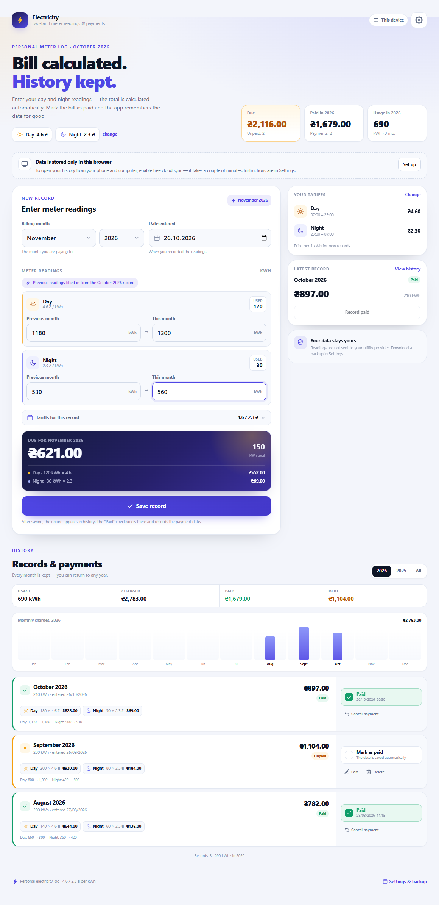
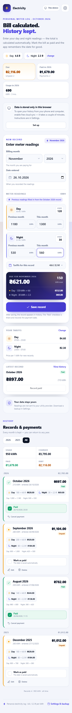
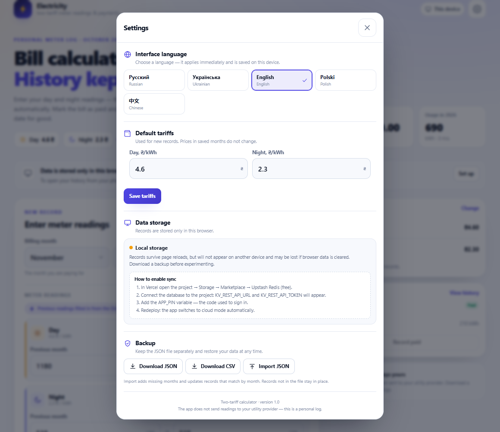

# Electricity — usage and payments

An online calculator for electricity bills with **day** and **night** tariffs. Enter
your previous and current meter readings, and the app calculates consumption in kWh
and the amount due. The history of calculations and payments is kept for years.

**Live app:** https://elektro-raschet.vercel.app (owner PIN required)  
**Repository:** https://github.com/Sokolyanskyi/elektro-raschet

> The interface is available in **English, Ukrainian, Polish, Chinese, and Russian**.
> The first launch follows the browser language; you can change it in **Settings**.
> All screenshots and the repository description use the English interface.



## Features

- **Two tariffs.** Defaults are 4.60 ₴/kWh for day and 2.30 ₴/kWh for night. Rates can
  be changed in Settings or directly in the calculation form.
- **Instant calculation.** Day usage, night usage, the total amount, and the
  day/night breakdown update as you type.
- **Reading entry date.** Saved together with every calculation.
- **One-click payment.** The “Mark as paid” checkbox records the actual payment date
  and locks itself. A paid record cannot be edited or deleted until you explicitly
  choose “Cancel payment”.
- **Multi-year history.** Filter by year, see yearly totals (usage, charged, paid,
  debt), and a monthly charges chart. Records are never removed automatically.
- **Same data on every device.** Local mode works out of the box; cloud mode syncs
  history between phone and computer after entering a PIN.
- **Backups.** Export to JSON or CSV (Excel-friendly), import JSON with duplicate-safe
  merging.
- **Historical rates are preserved.** Every record snapshots the rates in effect when
  it was saved, so old amounts never change retroactively. New records use the
  current default rates.
- **Installable on a phone.** PWA manifest and icons; add it to the home screen.
- **Light and dark themes.** Follows the system preference and adapts from 320 px up.
- **Five languages.** English, Ukrainian, Polish, Chinese, and Russian. Switch in
  Settings — the choice is remembered on the device; dates, numbers, and currency use
  locale-aware formatting.
- **Accessible by design.** Labelled fields, keyboard-friendly dialogs, visible focus
  states, and `role`/`aria` attributes on tabs and language choices.

<p align="center">
  
</p>

## Languages

The interface is fully translated into five languages. The language is picked in
Settings, applied instantly, and remembered on the device; the very first launch
follows the browser language. Dates, month names, numbers, kWh, and currency use
locale-aware `Intl` formatting, and server errors are translated on the client.

<p align="center">
  
</p>

## How the amount is calculated

For each tariff:

```
usage = current reading − previous reading
cost  = usage × rate
total = day cost + night cost
```

Example: day 1,000 → 1,180 kWh (180 kWh × 4.60 ₴ = 828.00 ₴), night 500 → 530 kWh
(30 kWh × 2.30 ₴ = 69.00 ₴). **Total: 897.00 ₴.**

Amounts are rounded to the nearest kopeck. Only one record per billing month is
allowed.

## Tech stack

- [Next.js 16](https://nextjs.org/) (App Router, Turbopack) + React 19 + TypeScript
- Hand-written CSS with no external UI libraries or web fonts
- Vitest for unit tests
- Vercel KV / Upstash Redis (REST) for optional cloud sync

## Local development

Requires Node.js 20.9+ (tested on Node 24).

```bash
npm install
npm run dev
```

Open http://localhost:3000. With no environment variables the app runs in local mode
and stores data in the browser's `localStorage`.

Other commands:

```bash
npm run typecheck   # type checking
npm test            # unit tests
npm run build       # production build
npm start           # run the production build
```

## Cloud sync (phone + computer)

By default, data lives only in the current browser. To share one history across all
devices, connect a free cloud database:

1. Deploy the project to Vercel (see below).
2. In the Vercel project, open **Storage → Marketplace → Upstash Redis** and create a
   free database connected to the project.
3. Vercel adds `KV_REST_API_URL` and `KV_REST_API_TOKEN` (or
   `UPSTASH_REDIS_REST_URL` / `UPSTASH_REDIS_REST_TOKEN`).
4. Add an `APP_PIN` variable — the code used to sign in.
5. Redeploy. The app switches to cloud mode automatically.

| Variable | Required | Purpose |
| --- | --- | --- |
| `KV_REST_API_URL` | for cloud mode | Upstash REST endpoint |
| `KV_REST_API_TOKEN` | for cloud mode | Database access token |
| `APP_PIN` | for cloud mode | Sign-in PIN (for example, 4–8 digits) |

The alternative names `UPSTASH_REDIS_REST_URL` / `UPSTASH_REDIS_REST_TOKEN` are also
supported. If only some of the variables are present, the app stays in local mode.

### How it works

- Records are stored in Upstash as `elec:rec:<id>` plus an `elec:ids` set.
- The PIN is verified on the server; an httpOnly session cookie is issued for 120 days.
- PIN comparison uses SHA-256 with a timing-safe check. Ten failed attempts within
  15 minutes block sign-in from that IP.
- Paid records are locked on both the client and the server (HTTP 409) until an
  explicit `{ "unlock": true }` request arrives.
- API routes return `401` without a valid session.

> The PIN protects a personal dashboard; it is not a full multi-user authentication
> system. Avoid sharing the app link publicly unless you need to.

## Deploying to GitHub and Vercel

The project is already published. To redeploy or fork it:

The local repository is initialized on the `main` branch. If GitHub CLI is installed
and `gh auth login` has been completed:

```bash
gh repo create elektro-raschet --public --source=. --remote=origin --push
```

Without GitHub CLI:

1. Create an empty repository on GitHub (no README or .gitignore).
2. Run:

```bash
git remote add origin https://github.com/<your-login>/elektro-raschet.git
git branch -M main
git push -u origin main
```

Deploying to Vercel:

- **Dashboard:** [vercel.com/new](https://vercel.com/new) → Import Git Repository →
  select the repository → Framework Preset: **Next.js** → Deploy.
- **CLI:**

```bash
npm i -g vercel
vercel
vercel --prod
```

After the first deployment, add the cloud environment variables (see above) in
**Settings → Environment Variables** and redeploy.

## Backups and data migration

In the app's Settings:

- **Download JSON** — a full copy of records and tariffs.
- **Download CSV** — an Excel-friendly table (`;` separator, decimal comma, BOM).
- **Import JSON** — adds new months and updates matching ones; records missing from
  the file are left untouched. Duplicate months and invalid rows are skipped.
- **Move N records from this device** — in cloud mode, uploads local records to the
  cloud (useful if you started using the app before connecting a database).

## Project structure

```
app/
  api/auth/            PIN sign-in and sign-out
  api/records/         Record CRUD and bulk import
  api/status/          Storage mode and session state
  layout.tsx           Metadata, PWA, service worker
  page.tsx             Main page
  globals.css          Design system, responsive layout, dark theme
components/            Form, history, record cards, settings, modals
lib/
  calc.ts              Calculations, number parsing, validation keys
  format.ts            Locale-aware money, date, month, and number formatting
  i18n/                Five message catalogues, locale detection, translation
  client/              localStorage, API client, hooks, export/import
  server/              Upstash REST client, sessions, PIN, record sanitization
tests/                 Unit tests for calculations, backups, and i18n
```

## Limitations

- This is a personal ledger, not an integration with an electricity supplier;
  readings are never sent anywhere.
- In local mode, data is not synced between devices and can be lost if browser data
  is cleared — download a JSON backup regularly.
- Cloud mode requires a configured Upstash database and the `APP_PIN` variable.

## License

MIT. Use and adapt it to your own tariffs.
